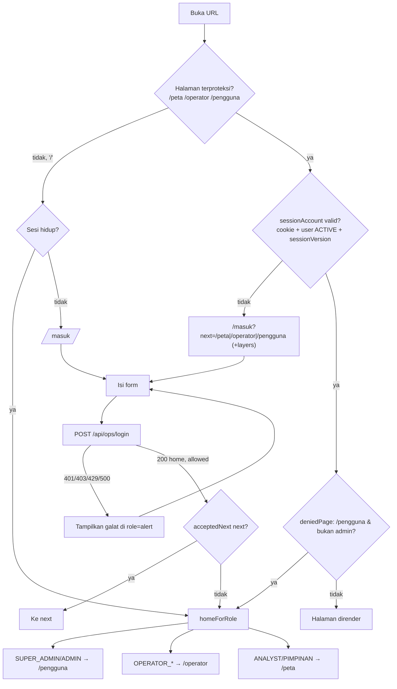

# 04 — Alur Pengguna ATLAS (AS-IS)

> Catatan 12 November 2026: `FlightWatchPanel` dan tesnya sudah dihapus bersama pelacakan pesawat dan satelit.

Tanggal pemeriksaan: 2026-10-30. Rujukan halaman ada di `01_ATLAS_PAGE_INVENTORY.md`.

Dokumen ini hanya menyebut nama field body permintaan, tanpa nilainya. Pesan galat dikutip persis dari kode.

**Jenis bukti**

| Label | Arti |
|---|---|
| `test` | Dibuktikan oleh tes vitest yang lulus (95/95 pada 16 berkas, 2026-10-30) |
| `runtime` | Dibuktikan oleh GET tanpa sesi ke `localhost:3000` |
| `code-only` | Hanya dari pembacaan kode |

Tidak ada tes UI atau E2E, dan pemeriksaan ini tidak memakai login. Karena itu, setiap langkah yang terjadi di UI berstatus code-only.

**Pesan umum di sisi proxy** (`src/proxy.ts`):

| Kondisi | Respons |
|---|---|
| API tanpa sesi | 401 `Masuk diperlukan.` |
| API admin untuk non-admin | 403 `Peran ini tidak memiliki izin.` |
| Tulis lintas situs | 403 `Permintaan lintas situs ditolak.` |

---

## 1. Login dan perutean per peran

- **Titik awal**: `/masuk`. Halaman ini juga dicapai lewat `/` atau saat halaman terproteksi dibuka tanpa sesi, dengan `?next=`.
- **Langkah**:
  1. Pengguna mengisi nama pengguna dan kata sandi, dengan opsi "Ingat saya".
  2. Klien menolak isian kosong dengan pesan `Nama pengguna dan kata sandi wajib diisi.` (`login-form.tsx:24-27`).
  3. Klien mengirim permintaan berikut.
- **Request**: `POST /api/ops/login`, body `{username, password, remember}` (`login-form.tsx:31-35`).
- **Server** (`src/app/api/ops/login/route.ts`):
  - Rate limit tiga ember per 15 menit: per IP 30, per IP dan nama pengguna 8, per nama pengguna 20 (`:27-34`).
  - Verifikasi hash. Bila akun tidak ada, tetap dibandingkan dengan hash dummy (`:35-36`).
  - Memeriksa status `active` dan `ACTIVE`.
  - Memperbarui `lastLoginAt`, menerbitkan cookie `osiris_ops`. Masa berlakunya 8 jam, atau 14 hari bila memilih "ingat" (`src/lib/ops/session.ts:2-3`).
  - Menulis audit `login_success` atau `login_failure`.
- **Sukses**: `200 {ok, role, home, allowed}`. Klien lalu menjalankan `window.location.assign(acceptedNext(next, allowed) ?? home)` (`login-form.tsx:47-49`).
- **Gagal**:

| Kondisi | Respons | Rujukan |
|---|---|---|
| Body rusak, akun tak dikenal, atau sandi salah | 401 `Nama pengguna atau kata sandi salah.` | `:11` |
| Rate limit | 429 `Terlalu banyak percobaan. Coba lagi nanti.` | — |
| Akun pending atau nonaktif | 403 `Akun belum dapat masuk. Menunggu persetujuan atau tidak aktif.` | — |
| Secret sesi belum diset | 500 `Sesi belum dikonfigurasi.` | — |
| Gagal jaringan (klien) | `Jaringan bermasalah. Coba lagi.` | — |
| Galat lain (klien) | `Masuk gagal.` | — |

- **Redirect per peran** (`homeForRole`): SUPER_ADMIN dan ADMIN → `/pengguna`. OPERATOR_PUSDALOPS dan OPERATOR_KODAM → `/operator`. ANALYST dan PIMPINAN → `/peta`.
  - Tujuan `next` hanya diterima bila ada di `allowedNext`: admin `/pengguna, /operator, /peta, /`; selain admin `/operator, /peta, /`. Parameter yang dipertahankan hanya `layers`.
- **Masalah UX (code-only)**:
  - Form tetap tampil untuk pengguna yang sudah login.
  - Fallback `home` di klien adalah `/operator` (`:47`), bukan home sesuai peran, bila respons tidak membawa `home`.
  - `/peta/multiview` tanpa sesi kembali ke `/peta` (runtime).
  - Pesan 403 untuk akun pending membedakan "akun ada dan sandi benar" dari "salah". Ini disengaja, tetapi tetap memberi informasi.
- **Bukti**:
  - test: `login/route.test.ts`, 7 tes (cookie httpOnly, pesan yang sama, home tiap peran, akun nonaktif/pending, rate limit); `rbac.integration.test.ts:108-124`; `access.test.ts` (`acceptedNext`).
  - runtime: pengalihan tanpa sesi berikut `next`.
  - code-only: langkah UI.



## 2. Logout

- **Titik awal**: `PortalMenu`, item "Keluar" (`src/components/ops/portal-menu.tsx:37-41`, `:90-93`). Menu ini ada di `/peta`, `/operator`, dan `/pengguna`. `OperatorBoard` juga punya tombol "KELUAR" (`operator-board.tsx:99-102`), tetapi tombol itu tersembunyi karena `/operator` memakai `showChrome={false}`.
- **Request**: `POST /api/ops/logout`, tanpa body.
- **Server** (`logout/route.ts:9-23`): bila sesi cocok, `sessionVersion` dinaikkan dan audit `logout` ditulis. Cookie selalu dihapus.
- **Sukses**: 200, lalu `window.location.assign('/masuk')`. Galat jaringan diabaikan (`.catch`) dan pengalihan tetap terjadi.
- **Perubahan state**: semua sesi akun itu di semua perangkat ikut tidak berlaku, karena `sessionVersion` naik.
- **Masalah UX**:
  - Logout di satu perangkat juga mengeluarkan perangkat lain tanpa pemberitahuan.
  - Tidak ada konfirmasi.
  - Label "Keluar..." hanya tampil selama permintaan berjalan.
- **Bukti**: code-only. `rbac.integration.test.ts` hanya menguji bahwa versi sesi yang tidak cocok ditolak.

## 3. Pendaftaran

- **Titik awal**: `/daftar` (tautan "Daftar akun" di `/masuk`).
- **Langkah**: isi tujuh field. Validasi klien memeriksa regex nama pengguna, email, `passwordProblem`, dan konfirmasi (`register-form.tsx:26-42`).
- **Request**: `POST /api/ops/register`, body `{name, username, email, organization, position, password, confirmPassword}`.
- **Server** (`register/route.ts`):
  - Rate limit 5 per jam per IP.
  - `parseRegister` (`access.ts:317-339`).
  - Membuat user `role=ANALYST`, `active=false`, `accountStatus=PENDING`, lalu menulis audit `register/pending`.
  - Bila nama pengguna atau email sudah ada, akun tidak dibuat dan audit ditulis sebagai `duplicate`, tetapi **respons tetap sama**, untuk mencegah enumerasi akun.
- **Sukses**: 201 `Pendaftaran diterima. Akun menunggu persetujuan Admin.` Form diganti panel status dan tombol "Kembali ke masuk". Tidak ada sesi yang diterbitkan.
- **Gagal (400)**:
  - `Data pendaftaran tidak lengkap.`
  - `Nama lengkap 2–120 karakter.`
  - `Nama pengguna 3–32 karakter: huruf kecil, angka, titik, garis bawah, atau strip.`
  - `Email tidak valid.`
  - `Satuan atau instansi 2–120 karakter.` / `Pangkat atau jabatan 2–120 karakter.`
  - Pesan kebijakan kata sandi: `Kata sandi minimal 12 karakter.`, `Kata sandi tidak boleh memuat nama pengguna.`, `…mudah ditebak…`, `…satu karakter yang diulang.`, `Kata sandi terlalu panjang.` (`prisma/password-policy.mjs:19-26`).
  - `Konfirmasi kata sandi wajib diisi.` / `Konfirmasi kata sandi tidak sama.`
- **Gagal (lain)**: 429 `Terlalu banyak percobaan. Coba lagi nanti.`
- **Hak akses**: publik.
- **Masalah UX**:
  - Pendaftar dengan nama atau email duplikat menerima pesan sukses dan tidak akan pernah disetujui, tanpa petunjuk apa pun. Ini disengaja.
  - Tidak ada notifikasi ke admin, dan pendaftar tidak diberi tahu saat disetujui.
  - Galat tidak ditandai per isian. Semua galat muncul di satu banner.
- **Bukti**: test (`register/route.test.ts` 2 tes; `access.test.ts` untuk `parseRegister`; `password-policy.test.ts` 15 tes), runtime (`/daftar` 200), code-only (UI).

## 4. Persetujuan akun

- **Titik awal**: `/pengguna`, bagian "Menunggu persetujuan". Kartunya selalu terbuka (`user-board.tsx:147-149`).
- **Langkah**:
  1. Admin boleh mengubah nama, peran, dan Kotamaops di kartu. Kotamaops hanya aktif untuk OPERATOR_KODAM.
  2. Admin menekan **Setujui** atau **Tolak** (`:292-300`).
- **Request**: `PATCH /api/ops/users/:id`, body `{name, role, kotamaopsId, password:"", confirmPassword:"", accountStatus}` dengan `accountStatus` bernilai `ACTIVE` atau `REJECTED` (`user-board.tsx:99-115`).
- **Server** (`users/[id]/route.ts`):
  1. 401 atau 403 dari gerbang.
  2. 404 `Pengguna tidak ditemukan.`
  3. Penguncian SUPER_ADMIN.
  4. `parseUserPatch`.
  5. `nextAccountState` (`access.ts:172-187`): `accountStatus=ACTIVE` berarti `active=true`.
  6. Audit `account_approve` atau `account_reject` (`:10-17`, `:79-89`), ditambah `role_change` bila peran diubah.
- **Sukses**: 200 berisi user. Kartu pindah ke "Akun terdaftar", lalu muncul banner `<username> disimpan.`
- **Gagal**:
  - 400 `Operator Kodam wajib diikat ke satu Kotamaops.`
  - 400 `Kotamaops tidak ditemukan.`
  - 403 `Hanya super admin yang dapat mengubah peran super admin.`
  - Galat lain (klien): `Perubahan gagal disimpan.`
- **Hak akses**: SUPER_ADMIN dan ADMIN. ADMIN tidak bisa memberi peran SUPER_ADMIN.
- **Masalah UX**:
  - Setujui dan Tolak tidak meminta konfirmasi dan tidak menampilkan state busy, sehingga klik ganda mengirim dua PATCH.
  - Isian kata sandi tampil di kartu pending tetapi diabaikan saat menyetujui, karena nilainya dikirim sebagai `""`.
  - Peran bawaan pendaftar adalah ANALYST ("Viewer"). Admin harus ingat mengganti peran **sebelum** menekan Setujui.
  - Akun REJECTED bisa diaktifkan kembali lewat "Aktifkan" tanpa jejak alasan.
- **Bukti**: test (`users/route.test.ts` untuk aturan SUPER_ADMIN dan admin terakhir; `access.test.ts` untuk `nextAccountState`); code-only (UI dan audit approve).

```mermaid
flowchart TD
  R[Pendaftar: POST /api/ops/register] --> P[(User PENDING, ANALYST, active=false)]
  P --> L{Pendaftar coba login}
  L --> L403[403: Akun belum dapat masuk...]
  P --> A[Admin buka /pengguna → Menunggu persetujuan]
  A --> E[Opsional: ubah nama/peran/Kotamaops di kartu]
  E --> D{Keputusan}
  D -- Setujui --> PA["PATCH /api/ops/users/:id {accountStatus: ACTIVE, role, kotamaopsId, name}"]
  D -- Tolak --> PR["PATCH ... {accountStatus: REJECTED}"]
  PA --> V{Validasi server}
  PR --> V
  V -- KODAM tanpa unit / unit tak ada / grant SUPER_ADMIN oleh ADMIN --> ERR[400/403 → banner galat]
  V -- ok --> OK1[ACTIVE + audit account_approve (+role_change)]
  V -- ok --> OK2[REJECTED + audit account_reject]
  OK1 --> LOGIN[Pengguna dapat login → homeForRole]
  OK2 --> RE[Admin dapat 'Aktifkan' kemudian → account_enable]
```

## 5. Manajemen pengguna: tambah

- **Titik awal**: `/pengguna`, aside "Pengguna baru" (`user-board.tsx:171-209`).
- **Field**: Nama, Nama pengguna, Kata sandi (satu isian, tanpa konfirmasi), Peran (bawaan `OPERATOR_KODAM`), dan Kotamaops (bawaan "Tanpa Kotamaops").
- **Request**: `POST /api/ops/users`, body `{name, username, password, role, kotamaopsId}`.
- **Server** (`users/route.ts:21-56`): `parseNewUser` (`access.ts:236-254`), lalu memeriksa peran SUPER_ADMIN dan keberadaan unit. Bila lolos, akun dibuat langsung `ACTIVE` dan audit `account_create` ditulis.
- **Sukses**: 201. Daftar diurutkan ulang, form direset, dan muncul `<username> dibuat.`
- **Gagal**:
  - 400: `Nama 2–120 karakter.`, pesan nama pengguna, pesan kebijakan kata sandi, `Peran tidak dikenal.`, `Operator Kodam wajib diikat ke satu Kotamaops.`, `Kotamaops tidak ditemukan.`
  - 403: `Hanya super admin yang dapat mengubah peran super admin.`
  - 409: `Nama pengguna sudah dipakai.`
  - Galat lain (klien): `Pengguna gagal dibuat.`
- **Masalah UX**:
  - Nilai bawaan saling bertentangan: peran OPERATOR_KODAM dengan "Tanpa Kotamaops" pasti gagal pada submit pertama.
  - Tidak ada konfirmasi kata sandi. Ini tidak konsisten dengan alur edit dan daftar.
  - Isian kata sandi tidak punya tombol tampilkan.
  - `fetch` tidak dibungkus try/catch (`:78`), sehingga galat jaringan tidak menampilkan pesan apa pun.
  - Tidak ada state busy, sehingga klik ganda bisa memicu 409.
  - Field email, instansi, dan jabatan tidak bisa diisi untuk akun buatan admin.
- **Bukti**: test (`users/route.test.ts`, penolakan admin membuat SUPER_ADMIN; `access.test.ts`, KODAM wajib unit); code-only (UI).

## 6. Edit pengguna

- **Titik awal**: `/pengguna`, kartu di "Akun terdaftar". Klik kartu untuk membukanya (`openId`).
- **Langkah**:
  1. Ubah nama, peran, Kotamaops, atau centang "Aktif" (`:263-288`).
  2. Klik **Simpan pengguna**.
  3. Sebagai alternatif, klik **Nonaktifkan** (bila ACTIVE) atau **Aktifkan** (bila DISABLED/REJECTED).
- **Request**:
  - Simpan pengguna: `PATCH /api/ops/users/:id`, body `{name, role, kotamaopsId, password, confirmPassword, active}`.
  - Nonaktifkan atau Aktifkan: field `accountStatus` menggantikan `active`.
- **Server**:
  - Akun SUPER_ADMIN hanya bisa diubah oleh SUPER_ADMIN (403 `Hanya super admin yang dapat mengubah akun super admin.`).
  - SUPER_ADMIN aktif terakhir tidak bisa diturunkan (400 `Super admin aktif terakhir tidak dapat diturunkan.`).
  - Bila status berubah dari ACTIVE ke tidak aktif, `sessionVersion` dinaikkan (`:54`).
  - Audit `role_change`, `account_disable`, atau `account_enable`.
- **Gagal (lain)**: 400 `Status aktif harus ya atau tidak.` dan `Status akun tidak dikenal.`
- **Masalah UX**:
  - Perubahan nama, peran, atau centang yang belum disimpan langsung tampil di badge kartu, seolah sudah tersimpan.
  - Perubahan itu tidak dikembalikan saat gagal, kecuali halaman dimuat ulang.
  - Tidak ada konfirmasi untuk Nonaktifkan.
  - Tabel "Jejak autentikasi" tidak ikut diperbarui sesudah aksi.
  - Tidak ada pencarian atau paginasi daftar pengguna.
- **Bukti**: test (`users/route.test.ts` 14 tes); code-only (UI).

## 7. Perubahan kata sandi oleh admin

- **Titik awal**: kartu pengguna (non-pending), isian "Kata sandi baru, kosongkan jika tetap" dan "Ulangi kata sandi baru" (`user-board.tsx:289-290`).
- **Request**: sama dengan alur 6, dengan `password` dan `confirmPassword` dibaca dari DOM (`:306-308`).
- **Server**:
  - `parseUserPatch` (`access.ts:291-298`): kata sandi kosong berarti tidak diubah. Bila diisi, wajib lolos kebijakan dan **`confirmPassword` wajib sama**. Bila tidak, server menjawab 400 `Konfirmasi kata sandi tidak sama.`
  - Route memeriksa ulang terhadap nama pengguna pemilik akun (`users/[id]/route.ts:33-34`).
  - Bila lolos: hash diganti, `sessionVersion++` (semua sesi target dicabut), dan audit `password_change` ditulis.
- **Masalah UX**:
  - Kedua isian dikosongkan **segera setelah klik**, sebelum respons datang (`:309-310`). Bila server menolak, admin harus mengetik ulang.
  - Tidak ada pemeriksaan kecocokan di klien, dan tidak ada tombol tampilkan.
  - Mengganti kata sandi akun sendiri ikut mengeluarkan sesi admin itu, tanpa peringatan.
- **Bukti**: test (`users/route.test.ts:275-278`, `confirmPassword` yang `undefined`, `""`, atau berbeda ditolak; `access.test.ts:107-140`); code-only (UI).

## 8. Lupa dan reset kata sandi

- **Titik awal**: `/masuk` → "Lupa kata sandi" → `/lupa-sandi`.
- **Langkah A (permintaan)**:
  - Request: `POST /api/ops/password/forgot`, body `{email}`.
  - Server (`forgot/route.ts`):
    - Email tidak valid: 400 `Email tidak valid.`
    - Rate limit 5 per jam per IP dan 5 per jam per email: 429 `Terlalu banyak permintaan. Coba lagi nanti.`
    - Akun hanya ACTIVE atau PENDING.
    - Bila SMTP dan `OPS_PUBLIC_URL` siap: token disimpan sebagai hash, berlaku 30 menit, lalu surel dikirim.
  - Respons selalu 200 `Jika email terdaftar dan layanan surel tersedia, tautan reset dikirim. Jika pesan tidak datang, periksa alamat atau konfigurasi surel.`
- **Langkah B (atur ulang)**:
  - Titik awal: tautan surel `/atur-sandi?token=…`.
  - Request: `POST /api/ops/password/reset`, body `{token, password, confirmPassword}`.
  - Gagal (400):
    - `Tautan reset tidak berlaku.`
    - `Tautan reset sudah dipakai.`
    - `Tautan reset sudah kedaluwarsa.` (`reset-token.ts:32-35`)
    - Pesan kebijakan kata sandi
    - `Konfirmasi kata sandi tidak sama.`
  - Gagal (429): `Terlalu banyak percobaan. Coba lagi nanti.`
  - Sukses: `Kata sandi diperbarui. Masuk dengan kata sandi baru.` Semua sesi dicabut (`sessionVersion++`).
  - Tanpa token di URL: `Tautan reset tidak lengkap.` disertai tautan "Minta tautan baru".
- **Status**: **UNVERIFIED** untuk pengiriman surel ujung-ke-ujung, karena SMTP mungkin belum dikonfigurasi. Bila SMTP tidak siap, server hanya menulis audit `unconfigured` dan pengguna tetap melihat pesan netral.
- **Masalah UX**:
  - Pengguna tidak bisa membedakan "surel belum terkonfigurasi" dari "email salah".
  - Belum ada jalur alternatif di UI. Pemulihan admin memakai skrip (`admin-recovery`, di luar UI).
  - Halaman reset tidak memvalidasi kebijakan kata sandi di klien.
- **Bukti**: test (`forgot/route.test.ts` 1, `reset/route.test.ts` 3, `reset-token.test.ts` 2, `mail.test.ts` 4: "tidak mengklaim pesan bisa dikirim bila SMTP kosong"); runtime (halaman 200); SMTP nyata UNVERIFIED.

## 9. Navigasi ke dashboard per peran

- **Mekanisme**:
  - Sesudah login atau dari `/`, pengguna diarahkan ke `homeForRole`.
  - `PortalMenu` (ikon grid) menampilkan `portalLinks(role)` ditambah "Keluar".
  - Sidebar `/operator` menampilkan Dasbor/Peta/Situasi, plus Pengguna bila `canManage` (`operator-dashboard.tsx:151-156`).
  - Halaman `/pengguna` yang dibuka langsung oleh non-admin dialihkan (307) ke home peran, tanpa pesan.

| Peran | Home | Menu portal |
|---|---|---|
| SUPER_ADMIN, ADMIN | `/pengguna` | Peta situasi, Dasbor operator, Manajemen pengguna |
| OPERATOR_PUSDALOPS, OPERATOR_KODAM | `/operator` | Peta situasi, Dasbor operator |
| ANALYST (Viewer), PIMPINAN (Monitoring) | `/peta` | Peta situasi, Dasbor situasi (baca saja) |

- **Masalah UX**:
  - Home admin adalah manajemen pengguna, bukan ringkasan operasional.
  - Pengalihan diam-diam tanpa pesan "tidak berizin".
- **Bukti**: test (`rbac.integration.test.ts:108-124`, `gate.test.ts`); runtime (pengalihan tanpa sesi); code-only (menu).

## 10. Peta operasional

- **Titik awal**: `/peta` (home ANALYST/PIMPINAN, atau lewat menu). Bisa juga dari iframe di `/operator`.
- **Langkah**:
  1. Splash tampil sampai peta siap, paling lama 7 detik.
  2. Kamera terbang ke NKRI, kecuali pengguna sudah berinteraksi.
  3. Feed inti dimuat: `GET /api/earthquakes`, `/api/news`, `/api/weather`, dan `/api/stats`.
  4. Klik peta memicu `GET /api/geo/reverse` dan `/api/region-dossier` (dossier wilayah).
- **Perubahan state**:
  - `mapData` berisi gabungan feed.
  - `backendStatus` bernilai `connecting`, `connected`, atau `error`, dan tampil sebagai "STATUS: LIVE/…".
  - Feed yang menjawab 401 mengalihkan ke `/masuk?next=/peta`.
- **Masalah UX**:
  - Galat feed hanya muncul di console, tanpa pesan per layer.
  - Splash menunda akses selama 2,2 sampai 7 detik pada setiap kunjungan.
  - `GlobalStatusBar` mengambil `/api/earthquakes` lagi secara terpisah.
- **Bukti**: runtime (pengalihan); test unit komponen/API terkait (`LiveAlerts`, `DirectionsBar`, `FlightWatchPanel`, adaptor `api/*`); code-only untuk perilaku halaman. Visual UNVERIFIED.

## 11. Filter dan layer peta

- **Langkah**:
  1. Pengguna menyalakan atau mematikan layer di `LayerPanel` (desktop: sidebar; mobile: tab "LAYERS").
  2. `activeLayers` berubah.
  3. Feed yang terkait dimuat sekali (`onceFeeds`) atau dipolling (`pollFeeds`).
  4. URL diperbarui ke `?layers=` setelah 1,5 detik (`monitoring-dashboard.tsx:319-326`).
  5. Saat halaman dimuat, `?layers=` diterapkan kembali (`:300-305`).
  6. Tautan yang memuat `layers` tetap terbawa melewati login: proxy (`proxy.ts:36-37`) dan `acceptedNext` dengan batas 500 karakter.
- **Filter lain**:
  - Pencarian lokasi lewat `SearchBar` → `GET /api/geosearch?q=`.
  - Filter teks dan topik di `LiveAlerts`.
  - Gambar AOI lewat `DrawingToolbar` (disimpan di `localStorage`, ekspor GeoJSON, pemantauan masuk/keluar entitas).
- **Masalah UX**:
  - Status layer hanya ada di URL. Tidak ada preferensi per akun.
  - AOI hanya ada di satu browser.
- **Bukti**: test (`access.test.ts` untuk `acceptedNext` dengan `layers`; `gate.test.ts`); runtime (`/peta?layers=cctv` → `next=%2Fpeta%3Flayers%3Dcctv`); code-only selebihnya.

## 12. Pemantauan CCTV dan pemilihan kamera

- **Langkah**:
  1. Pengguna menyalakan layer CCTV (`cctv`, `cctv_jm`, atau `cctv_jakarta`). Katalog dimuat lewat `GET /api/cctv?...` (`src/lib/camera-catalog.ts:46`) dengan retry terbatas.
  2. Pengguna mengklik ikon CCTV. Klik itu memanggil `setActiveCamera` (`monitoring-dashboard.tsx:406`) dan membuka `CameraViewer`. Feed di-resolve lewat `GET /api/cctv/resolve?url=` dan diputar dengan HLS, iframe, atau gambar (`camera-feed-view.tsx:41-65`).
  3. Pengguna menekan **PILIH UNTUK SPACE** (`CameraViewer.tsx:108-114`). Kamera disimpan ke `localStorage['atlas.spaceCams']`.
  4. Panel `SpaceCam` muncul dari tombol strip kanan. Tautan di panel itu membuka `/peta/multiview` (`SpaceCam.tsx:66`).
  5. Di multiviewer, pengguna mengatur preset grid, halaman, dan layar penuh.
- **Token CCTV (admin)**:
  - `CctvTokenButton` → `GET/POST /api/cctv/tokens`.
  - Non-admin melihat `Peran ini tidak memiliki izin.` (403 dari proxy). Pengguna tanpa sesi melihat `Masuk sebagai admin untuk mengubah token.`
- **Empty state multiviewer**: "Belum ada CCTV dipilih. Di tab peta, klik CCTV lalu tekan PILIH UNTUK SPACE…"
- **Masalah UX**:
  - Pilihan kamera hanya tersimpan di satu browser.
  - Multiviewer tanpa sesi dialihkan ke `/peta`, bukan kembali ke multiviewer.
  - Tombol token tampil untuk semua peran.
  - Resolver yang gagal hanya diam-diam beralih ke tautan.
- **Bukti**: test (adaptor `api/cctv/*.test.ts`, `cctv/proxy/route.test.ts`, `cctv/tokens/route.test.ts`, `gate.test.ts` "token changes as admin APIs"); runtime (`/api/cctv/tokens` 401); code-only untuk UI.

## 13. Situasi Kotamaops: edit dan simpan

- **Titik awal**: `/operator`. Tautan "Perbarui" di tabel atau kartu mengarah ke `#satuan-<id>`, yang memilih satuan di form (`operator-board.tsx:51-61`). Pilihan juga bisa lewat dropdown "Kotamaops terdaftar".
- **Langkah**: ubah Status (KONDUSIF/WASPADA/SIAGA), Personel, Dikerahkan, Kejadian, dan Catatan, lalu klik "Simpan data terkini".
- **Request**: `PATCH /api/ops/situations/:id`, body `{status, personnel, deployed, incidentCount, note}`. Kunci per baris mencegah PATCH ganda (`situation-save.ts:41-66`).
- **Server** (`situations/[id]/route.ts`):
  - 403 `Peran ini hanya dapat membaca.`
  - 404 `Situasi tidak ditemukan.`, termasuk saat OPERATOR_KODAM mencoba satuan lain, supaya keberadaan baris tidak bocor.
  - `parseSituation`.
  - Dalam satu transaksi: update `situation` (dengan `updatedByName`) dan create `situationRevision`.
- **Sukses**: 200 berisi baris. `rows` diperbarui, entri ditambahkan ke "Riwayat simpanan" lokal, dan muncul `<KODE> diperbarui.`
- **Gagal (400)**:
  - `Status harus KONDUSIF, WASPADA, atau SIAGA.`
  - `<Label> harus bilangan bulat 0 sampai 1000000.`
  - `Personel dikerahkan tidak boleh melebihi jumlah personel.`
  - `Catatan maksimal 2000 karakter.`
  - `Data situasi tidak lengkap.`
- **Gagal (lain)**: jaringan atau galat tak dikenal → `Simpan gagal.`
- **Hak akses**: tulis untuk SUPER_ADMIN, ADMIN, OPERATOR_PUSDALOPS, dan OPERATOR_KODAM (satuan sendiri). ANALYST dan PIMPINAN hanya membaca, dengan isian dinonaktifkan.
- **Masalah UX**:
  - Isian angka tidak punya batas `max` di klien.
  - Tidak ada deteksi konflik: dua operator bisa saling menimpa (last-write-wins).
  - Pesan sukses dan galat hanya ada di satu banner.
  - Data situasi tidak di-refresh dari server tanpa muat ulang.
- **Bukti**: test (`situation-save.test.ts` 6, `access.test.ts` untuk `parseSituation`, `rbac.integration.test.ts` "filters and writes situations from the session role"); code-only (UI).

## 14. Jejak autentikasi (tampilan AuthAudit)

- **Titik awal**: `/pengguna`, bagian bawah "Jejak autentikasi (n terbaru)".
- **Data**: dibaca di server dengan `authAudit.findMany({ take: 80 })` (`pengguna/page.tsx:38-42`).
- **Kolom**: Waktu (WIB), Aksi (label Indonesia dari `auditLabel`, `:10-25`), Hasil, Pelaku → target, IP / detail.
- **Peristiwa yang dicatat**:
  - `login_success`, `login_failure` (denied/inactive/rate_limited), `logout`
  - `register` (pending/duplicate)
  - `password_reset_request` (sent/unconfigured/no_origin/mail_failed/unknown/not_active), `password_reset_complete`
  - `account_approve`, `account_reject`, `account_enable`, `account_disable`, `account_status`
  - `role_change`, `account_create`, `password_change`
- **API alternatif**: `GET /api/ops/audit`, khusus admin. Tidak dipakai oleh UI.
- **Empty state**: `Belum ada catatan.`
- **Masalah UX**:
  - Tidak ada filter, pencarian, paginasi, atau ekspor. Hanya 80 entri terbaru yang tampil.
  - Tabel tidak diperbarui sesudah aksi di halaman yang sama.
  - Nilai `Hasil` tampil sebagai kode mentah (`denied`, `rate_limited`).
- **Bukti**: test (`audit.test.ts` 4, redaksi hash dan cookie; `rbac.integration.test.ts:126-133`, audit hanya untuk admin); runtime (`/api/ops/audit` 401 tanpa sesi); code-only (tampilan).

## 15. Notifikasi dan alert (LiveAlerts)

- **Titik awal**: `/peta`, tombol "Live Alerts" di strip kanan (desktop, `monitoring-dashboard.tsx:1050`). Di mobile, alur ini tidak tersedia sebagai tab tersendiri. Yang ada hanya tab INTEL (`IntelFeed`).
- **Data**: `data.news`, `data.earthquakes`, dan `data.weather_events`. Ketiganya berasal dari polling dashboard: news 5 menit, weather 5 menit, gempa 15 menit.
- **Isi panel** (`src/components/LiveAlerts.tsx`):
  - Tab peringatan resmi (NOAA/NWS, GDACS, EONET), diurutkan menurut tingkat keparahan (`:521-527`).
  - Tab gempa (15 terbaru) dan berita (bendera breaking).
  - Feed live, yang memutar feed video melalui `onWatchFeed`.
  - Kotak cari dan chip filter.
  - Pin alert ke peta (`alert_pins`).
  - "Locate" untuk menerbangkan peta ke lokasi alert.
  - Tombol refresh, yang memanggil ulang `/api/news`.
  - `AiOverview`: `POST /api/ai/overview`, ringkasan AI yang menampilkan pesan galat sendiri (`AiOverview.tsx:154`, `:247`).
- **Perubahan state**: `pinnedAlertIds` diteruskan ke peta. Waktu relatif diperbarui setiap 30 detik (`:501`).
- **Masalah UX**:
  - Tidak ada notifikasi push, suara, atau badge saat alert baru masuk. Pengguna harus membuka panel sendiri.
  - Panel tertutup secara bawaan (`showAlerts=false`).
  - Panel tidak bisa diakses di mobile.
  - Label panel berbahasa Inggris (SEVERE/MODERATE/ADVISORY).
  - Status alert tidak dihubungkan dengan status situasi Kotamaops.
- **Bukti**: test (`LiveAlerts.test.ts` 9 tes untuk parsing peringatan, severity, dan hitung mundur; `news/route.test.ts`); code-only (UI, AiOverview). Tampilan AI overview UNVERIFIED (butuh login). Route ini tidak memanggil model eksternal: ringkasan dibuat heuristik di server (`src/app/api/ai/overview/route.ts:6-9`).

---

## Ringkasan bukti per alur

| Alur | Bukti terkuat | Status alur |
|---|---|---|
| Login + perutean peran | test + runtime | WORKING (API/routing); UI code-only |
| Logout | code-only | UNVERIFIED |
| Pendaftaran | test + runtime | WORKING (API); UI code-only |
| Persetujuan akun | test (aturan) | PARTIAL (UI tanpa konfirmasi/busy) |
| Tambah pengguna | test | PARTIAL (bawaan bertentangan, tanpa try/catch) |
| Edit pengguna | test | PARTIAL (state optimistis tanpa rollback) |
| Ganti kata sandi (admin) | test (`confirmPassword` ditegakkan server) | WORKING (server); UI code-only |
| Lupa/reset sandi | test | UNVERIFIED end-to-end (SMTP) |
| Navigasi per peran | test + runtime | WORKING |
| Peta operasional | runtime (gerbang) | UNVERIFIED |
| Layer/filter peta | test + runtime (`layers`) | UNVERIFIED (UI) |
| CCTV + multiviewer | test (adaptor) | UNVERIFIED |
| Situasi Kotamaops | test | WORKING (API/lock); UI code-only |
| Jejak autentikasi | test (akses) | UNVERIFIED (tampilan) |
| LiveAlerts | test (parser) | UNVERIFIED (UI dan AI overview) |
